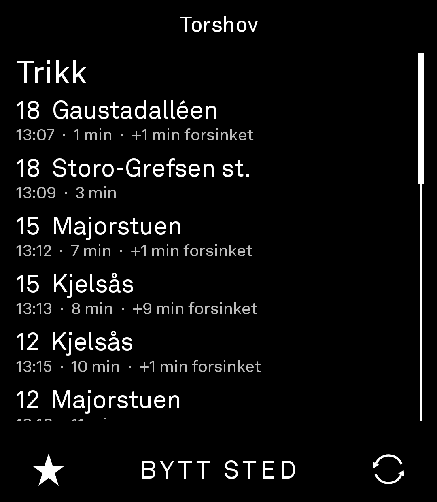
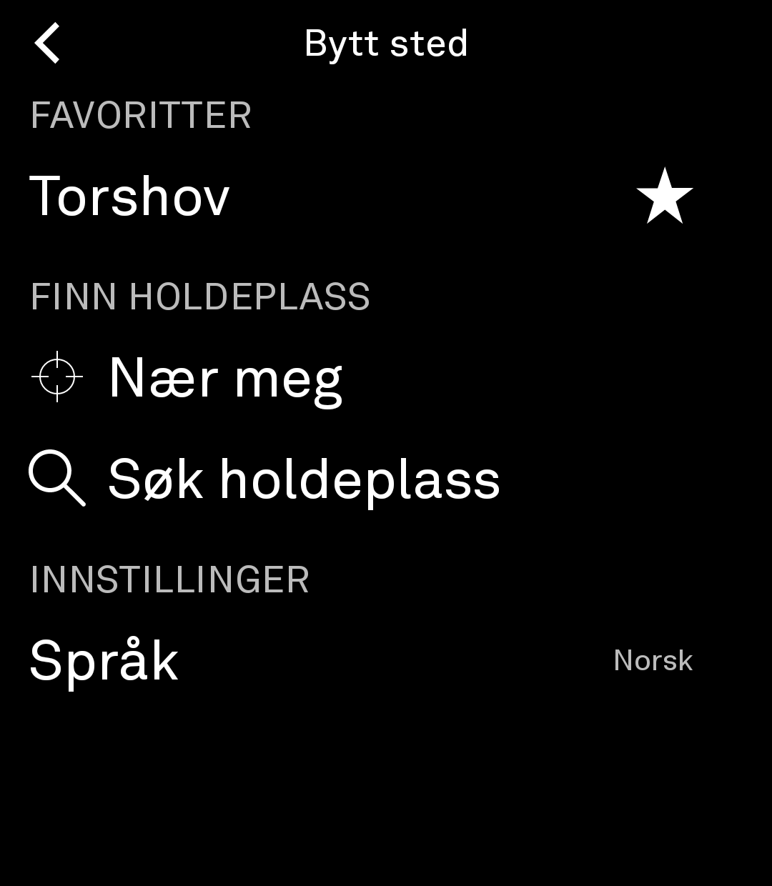
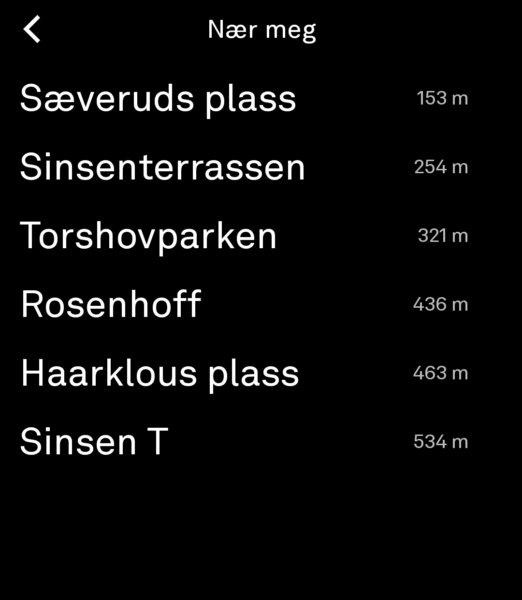

# Sanntid

Departure times for public transport anywhere in Norway, on the Light Phone III.

Opens straight onto the stop you used last. Built with the
[Light SDK](https://github.com/lightphone/light-sdk) over [Entur's](https://developer.entur.org)
national APIs. It covers bus, tram, metro, train, coach and ferry, countrywide.

| Departures | Change stop | Near me |
|---|---|---|
|  |  |  |

## Features

- Departures is the home screen, so there is no navigation to reach what you opened the app for
- Favourite stops, starred from the departures bar
- **Nær meg**: nearest stops with distances (see below)
- Search any stop in Norway, disambiguated by place ("Torshov, Oslo" vs "Torshov, Hamar")
- Realtime: delays, cancellations, `⚠` for service messages, `~` for timetabled-only
- Norwegian or English, switchable in-app. Stop names come from Entur and stay Norwegian in both.

## Install

Download the APK from [Releases](../../releases):

```sh
adb install -r Sanntid-release.apk
```

If it doesn't appear in the LightOS menu, restart the phone.

## Nær meg needs one adb command

LightOS does not currently grant location to SDK tools, so grant it once from outside the app:

```sh
adb shell pm grant com.thelightphone.sanntid android.permission.ACCESS_FINE_LOCATION
```

This survives app updates. Everything else works without it.

The SDK's build-time policy permits location, but the runtime permission server's grantable set is
camera and audio only, so its prompt refuses. `GetPermission` also reports `BlockedByServer` even
once the OS has granted the permission, so the app asks the platform directly. If LightOS widens that
set, Nær meg starts working with no change here.

There's no IP-geolocation fallback: measured on both broadband and mobile, the providers return the
same Oslo city centroid ~2.8 km off, with no overlap with the real nearest stops. Favourites and
search are the fallback instead.

## Building

Needs JDK 17 and a GitHub token with `read:packages`. See
[the SDK README](docs/LIGHT_SDK_README.md).

```sh
./gradlew :examples:Sanntid:assembleDebug
```

## Forking

**Change `CLIENT_NAME`** in
[`SanntidApi.kt`](examples/Sanntid/src/main/kotlin/com/thelightphone/sanntid/SanntidApi.kt). Entur
requires an `ET-Client-Name` of the form `<company>-<application>` and blocks unidentified
consumers. The default is shared by every unmodified build, so all that traffic is rate-limited as
one consumer.

**Other countries:** every network call is in that same file behind `searchStopPlaces`,
`nearbyStopPlaces` and `fetchDepartures`. Swap those and the rest of the app doesn't care. PRs
welcome; there's deliberately no configurable API setting.

## Layout

A fork of [`lightphone/light-sdk`](https://github.com/lightphone/light-sdk), which is how SDK tools
are distributed. Two additions:

- `examples/Sanntid/`: the app
- `sdk/client/.../LightLocation.kt`: lets tools read a position at all, since `getSystemService()`
  is blocked in tool modules. A standalone file extending `SealedLightContext`, mirroring upstream's
  `LightDb.kt`, so it adds no merge conflicts.

## Credits

Data from [Entur](https://developer.entur.org) ([NLOD](https://data.norge.no/nlod/en/2.0)). Built on
the [Light SDK](https://github.com/lightphone/light-sdk). MIT, matching upstream.

Not affiliated with The Light Phone, Entur, or Ruter.
